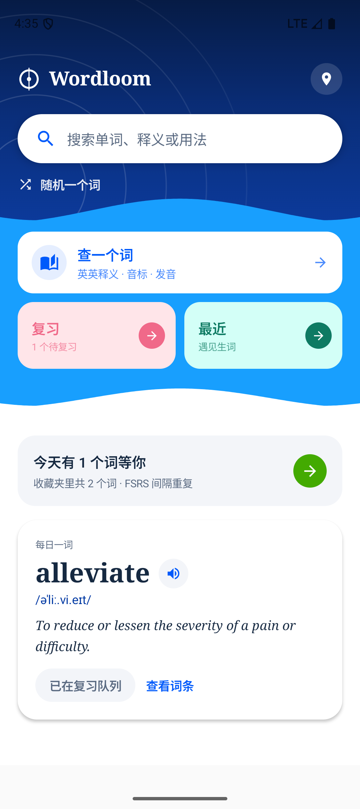
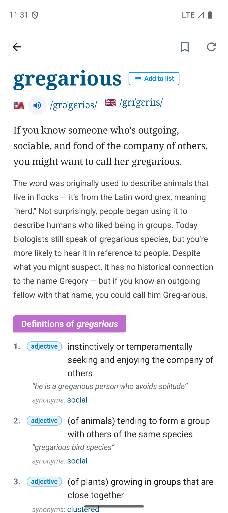
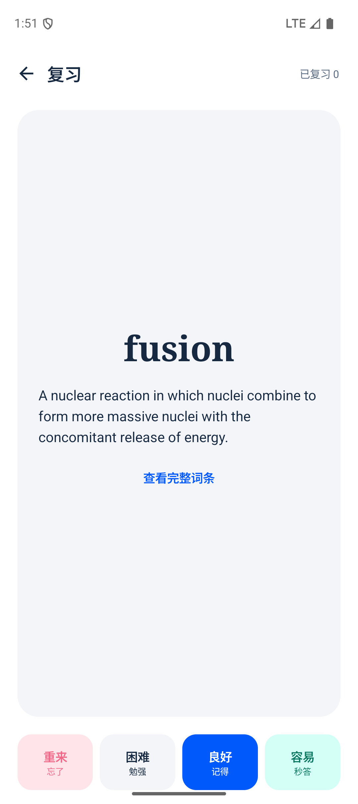
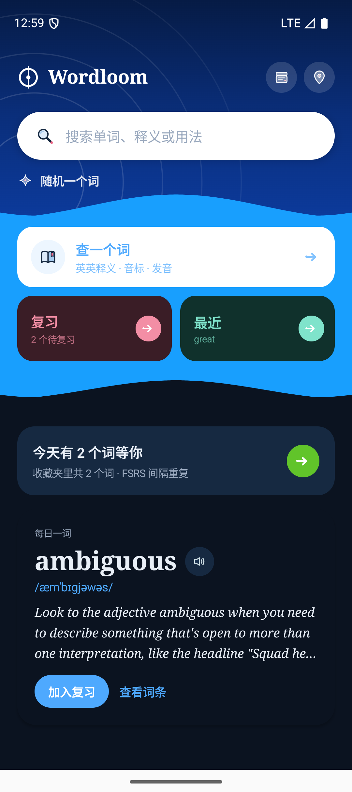
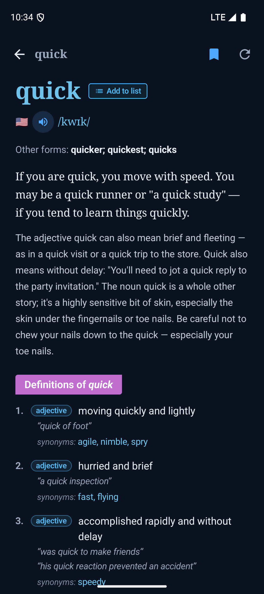
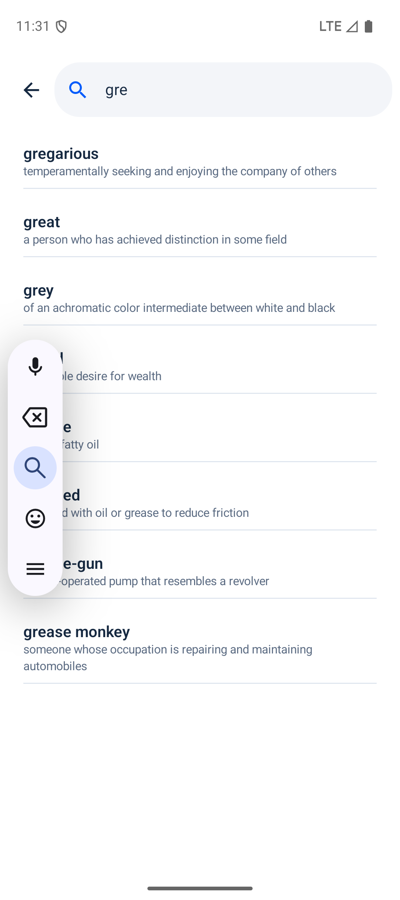
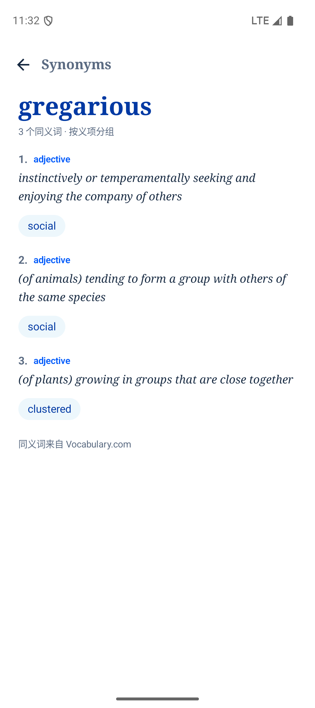
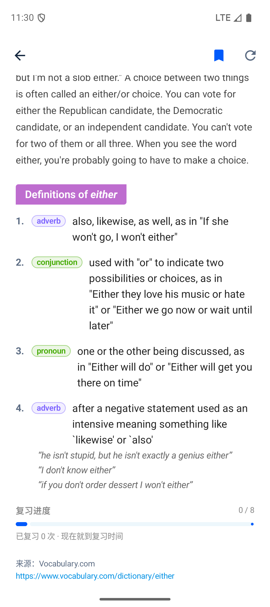

# Wordloom

一个**无登录、本地优先**的英英词典 + 间隔重复复习 App（Android / Kotlin / Jetpack Compose）。

界面语言参考了 vocabulary.com 的视觉调性（藏蓝衬线标题、波纹背景、释义横幅），代码、图标、
排版实现全部是原创的；不含任何第三方商标或 logo。

> 非官方项目，与 Vocabulary.com / IXL Learning 无任何关联。个人自用项目。

---

## 现在能做什么（v0.1）

| 功能 | 状态 |
|---|---|
| 英英查词（导读、其他形态、音标、释义、例句、synonyms） | ✅ |
| US / UK 发音播放 + 全部连读 | ✅ |
| 搜索联想（原站 `autocomplete-ss`，带一行释义） | ✅ |
| 词族（Word family，可点进任意派生词） | ✅ |
| 同义词详情页（按义项分组，词可点） | ✅ |
| 复习进度条（本地 FSRS 状态） | ✅ |
| 随机词 | ✅ |
| 收藏到复习队列 | ✅ |
| FSRS-5 间隔重复复习（四档评分） | ✅ |
| 本地缓存（30 天 TTL） | ✅ |
| 词表（新建 / 加词 / 详情） | ✅ |
| 每日一词 | ✅ |
| 拖拽 / 缩放世界地图（MapLibre + OpenFreeMap，无需 token） | ✅ |
| 地图自动巡航 + 轮播词卡 + 数字滚动 | ✅ |
| 深色模式 | ✅ 全站（词条页有独立的深色调色板，见 `WordLook`） |
| 离线包 / CSV 导入 / 导出备份 | ⬜ 路线图 |

**没有登录、没有账号、没有服务端。** 所有数据都在设备本地（Room + 30 天词典缓存），
换设备时导出数据库即可。

---

## 数据来自哪里

内容全部在**运行时**按需抓取 + 本地缓存，不打包任何词典正文。两层实现可互换：

| 实现 | 来源 | 说明 |
|---|---|---|
| `VocabularyComSource`（当前默认） | `www.vocabulary.com/dictionary/definition.ajax` | 本项目为个人自用，正文版权归 IXL Learning |
| `WiktionarySource`（兜底） | `en.wiktionary.org` REST + `action=parse` | CC BY-SA 4.0 |

`VocabularyComSource` 抓 `definition.ajax?search={word}&lang=en` 返回的 SSR 片段，用 Jsoup 取
`p.word-forms`（其他形态）、`p.short` / `p.long`（两段导读）、`.ipa-with-audio`（US/UK 音标与
`audio.vocabulary.com` 音频，一个区块可能带多条录音）、`li.sense`（词性、释义、例句、synonyms），
以及 `<vcom:wordfamily>` 里转义的 JSON（词族）。抓不到或没有内容时自动退回 Wiktionary。

搜索联想直接复刻原站 smart-search 的调用：`dictionary/autocomplete-ss?search={prefix}&maxResults=8`，
解析返回的 HTML 片段，所以每行都带一行释义。随机词走 `/randomword` 的 302 跳转取 Location；
这两条失败时都退回 Wiktionary（`action=opensearch` / `list=random`）。

词条正文（导读、释义、例句）由 Vocabulary.com 编辑撰写。本项目是个人自用，不打包正文、
运行时按需取并在词条页底部标注来源与原始链接。若将来改成对外分发，把 `WordloomApp.kt` 里
的默认实现换回 `WiktionarySource()` 即可。

### 换数据源

`data/remote/DictionarySource.kt` 是唯一的契约：

```kotlin
interface DictionarySource {
    val id: String
    val displayName: String
    suspend fun lookup(term: String): WordEntry?
    suspend fun suggest(prefix: String): List<String>
    suspend fun random(): String?
}
```

写一个实现，然后在 `WordloomApp.kt` 里替换 `AppContainer.source` 即可。计划中的实现：

- `WordNetSource`：离线，Princeton WordNet 许可宽松，适合做「无网也能查」
- `CustomGatewaySource`：指向你自己的解析网关（HTML→JSON 归一化放在服务端，解析规则改版可热更新）

---

## 关于「付费功能」

Vocabulary.com 的 VocabTrainer、词表进度、Bowl 排名都在**服务端按账号计算**，前端没有可翻的开关。
本项目因此走另一条路：

- **不碰**登录、付费墙、验证码，也不做批量抓取
- 复习算法**自研**（FSRS-5，公开算法，见 `srs/Fsrs.kt`）
- 进度**本地化**，不依赖任何账号

---

## 构建

需要 JDK 17+ 与 Android SDK（compileSdk 35）。本机已用 Android Studio 自带的 JBR 验证：

```bash
export JAVA_HOME="/Applications/Android Studio.app/Contents/jbr/Contents/Home"
./gradlew :app:assembleDebug
```

产物：`app/build/outputs/apk/debug/app-debug.apk`

```bash
adb install -r app/build/outputs/apk/debug/app-debug.apk
```

> 首次构建会下载 Gradle 依赖，约 3–5 分钟。

### 模拟器 / 国内网络的注意事项

如果宿主机走 HTTP 代理（`HTTP_PROXY`），模拟器默认**不会**继承，表现为查词一直转圈。
把模拟器的代理指向宿主机（`10.0.2.2` 是模拟器里的宿主机地址）：

```bash
adb shell settings put global http_proxy 10.0.2.2:7890   # 换成你的代理端口
```

真机不需要这一步；只要设备本身能访问 `en.wiktionary.org` 即可。

---

## 验证记录

在 Pixel 9a（Android 16 / API 36）模拟器上跑通了完整链路：

| 步骤 | 结果 |
|---|---|
| 首页渲染 | ✅ 渐变 hero + 波浪 + 三张卡 |
| 搜索 `quick` | ✅ 8 个义项（先显示 4 个，点「显示全部」展开）、US/UK 音标、`Other forms: quicker; quickest; quicks`、三段 synonyms |
| 搜索联想 `gre` | ✅ 8 条，来自原站 `autocomplete-ss`，每条带一行释义（gregarious / great / grey …） |
| 词族 + 同义词页 `great` | ✅ `greater / greatly / greatness / greats / greatnesses`；同义词 27 个按义项分组，点词可跳转 |
| 全部连读 `either` | ✅ 两条 US 录音并排，点「全部」依次播放 |
| 收藏 | ✅ 首页计数从 0 → 1，出现「最近查过」 |
| 复习 | ✅ 翻卡 → 评分「良好」→ 「已复习 1」 |
| FSRS 落库 | ✅ `stability=3.173`、`difficulty=5.282`、`due=3 天后`，与公式手算一致 |
| 地图 | ✅ 瓦片加载、英文标签、自动巡航（欧→东亚镜头移动已验证）、轮播词卡切换 |

|  |  |  |
|---|---|---|
| 首页 | 词条页 | 复习卡 |

|  |  |  |
|---|---|---|
| 深色首页 | 深色词条页 | 搜索联想 |
|  |  | |
| 同义词页 | 词族 / 复习进度 | |

## 目录结构

```
app/src/main/java/dev/wordloom/
├── data/
│   ├── model/WordEntry.kt             领域模型（可序列化，用于缓存）
│   ├── remote/DictionarySource.kt     数据源契约
│   ├── remote/VocabularyComSource.kt  Vocabulary.com definition.ajax 解析（当前默认）
│   ├── remote/WiktionarySource.kt     Wiktionary 实现（REST + parse + opensearch，兜底）
│   ├── local/                         Room：词典缓存 / 复习卡片 / 词表
│   └── WordRepository.kt              缓存策略 / 收藏 / 复习落库 / 词表 CRUD
├── srs/
│   ├── Fsrs.kt                        FSRS-5 公式
│   └── Scheduler.kt                   评分 → 下次到期时间
└── ui/
    ├── theme/                         设计令牌（配色/字体，见 docs/DESIGN.md）
    ├── components/Waves.kt            波浪分割 / 搜索波纹
    ├── home/ search/ word/ review/    主流程界面
    ├── lists/                         词表列表 / 详情 / 加词弹窗
    ├── map/                           可拖拽世界地图 + 自动巡航（PassiveMapView）
    └── WordloomViewModel.kt           单一状态源
```

## 路线图

1. **CSV 导入词表**：粘贴 / 选文件导入，去重后批量落库
2. **离线包**：预打包 WordNet 子集（约 10 万词），无网可查
3. **导出/导入备份**：JSON 备份 Room 三张表，方便换机
4. **发布准备**：`git init`、LICENSE、切回 Wiktionary 数据源、隐私说明（无采集）

## 许可

- 应用代码：MIT
- 词典正文：**不随仓库分发**。默认 Vocabulary.com 源为个人自用，正文版权归 IXL Learning；
  公开发布请切到 `WiktionarySource`（CC BY-SA 4.0，App 内已署名）
- 音频：`audio.vocabulary.com`（Vocabulary.com 源）/ Wikimedia Commons（Wiktionary 源），
  来源链接保留在词条页底部
